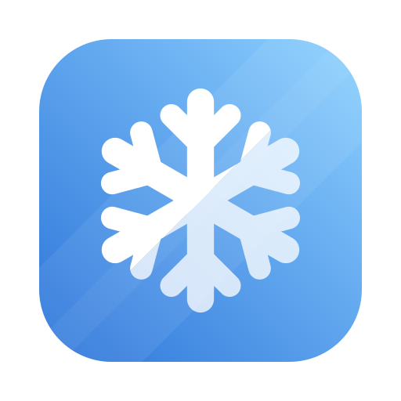

<p align="center">
  
</p>

<h1 align="center">Snowflake</h1>

<p align="center">Small, sharp tools for your Mac, all in one menu bar app.<br>Turn on only the ones you need.</p>

<p align="center">
  <a href="https://github.com/ChrisC920/Snowflake/actions/workflows/ci.yml"></a>
  
  
</p>

---

Snowflake is a personal, open-source utility app for macOS. It lives in the menu bar as a Liquid Glass panel of tool tiles. Every tool is a self-contained module you can turn on or off, and new tools drop in without touching the core.

## Tools

| Tool | What it does |
|---|---|
| **Keep Awake** | Keeps your Mac (and optionally the display) awake for 15 minutes, an hour, or until you turn it off. |
| **Clipboard** | Strips fonts, colors and links from copied text so it pastes as plain text. Click to clean, or clean automatically. |

More are on the way. See [Adding a tool](docs/ADDING_A_MODULE.md) to build your own.

## Install

Download `Snowflake.zip` from the [latest release](https://github.com/ChrisC920/Snowflake/releases/latest), unzip it and move **Snowflake.app** to Applications.

Releases are not notarized yet, so the first time you open Snowflake, right-click it in Finder and choose **Open**.

## Build from source

Requirements: macOS 15 or later, Xcode 26 or later, [Homebrew](https://brew.sh).

```bash
git clone https://github.com/ChrisC920/Snowflake.git
cd Snowflake
make bootstrap   # installs XcodeGen, SwiftLint, SwiftFormat; generates Snowflake.xcodeproj
make run         # builds and launches the app
```

Then open `Snowflake.xcodeproj` in Xcode if you prefer. Run `make help` for every command.

The Xcode project is generated from [`project.yml`](project.yml) and is not committed. Run `make generate` after adding or moving files.

## Project layout

```
Snowflake/                  App target: menu bar panel, Settings window, assets
Packages/SnowflakeKit/      Swift package
  Sources/SnowflakeKit/     Module protocol, registry, preferences, Frost theme, glass helpers
  Sources/SnowflakeModules/ Built-in tools, one folder each
Design/                     Icon and brand artwork (SVG sources)
Config/                     Build settings (.xcconfig)
scripts/                    Icon generation and other helpers
docs/                       Brand guide, how to add a tool
```

## Design

Snowflake follows Apple's Liquid Glass guidance for macOS 26 and later. Glass is used only for controls and navigation, and the app follows your system accent color by default, with optional "Frost" accents. On macOS 15 it falls back to standard materials. See [docs/BRAND.md](docs/BRAND.md).

## Contributing

Issues and pull requests are welcome. Read [CONTRIBUTING.md](CONTRIBUTING.md) first.

## License

[MIT](LICENSE)
